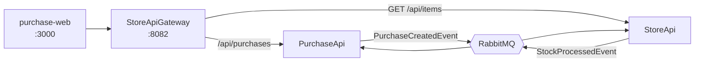

# purchase-web

Web front end for the purchase system. It lets the user create a purchase, follow the list of purchases and watch the status of each one change from `Pending` to `Confirmed` or `Rejected`. It talks only to the StoreApiGateway, never directly to the APIs.

## Features

- Create a purchase: choose an item, a quantity and a payment method; the total is calculated on screen.
- List purchases with the item name, quantity, total and status.
- Purchase detail with status, rejection reason, quantity, payment method and total.
- Automatic status updates, since the result of a purchase arrives asynchronously.
- Loading, empty and error states, including a lost connection with the API.

## Architecture



The front end only knows the gateway URL. The gateway forwards purchases to the PurchaseApi and exposes only `GET` for items (item registration is not available to the front end).

## Tech stack

- Next.js (App Router) and React
- TypeScript
- Tailwind CSS
- Fetch API, with a small HTTP helper

## Project structure

```
src/
  app/
    purchases/
      page.tsx          list and creation form
      [id]/page.tsx     purchase detail
  features/
    purchases/
      components/       PurchaseForm, PurchaseList, StatusBadge
      hooks/            usePurchasePolling, useCatalogNames
      services/         purchaseService (calls to the API)
      constants.ts      payment method labels
      types.ts          types that mirror the API contract
  shared/
    components/         Button, Card, Header, ErrorMessage
    http.ts             fetch wrapper and ApiError
    formatCurrency.ts   BRL formatting
```

The `app` folder only holds routes. Each feature keeps its own types, services, hooks and components, and `shared` holds what is not specific to purchases.

## Running

Prerequisites: Node.js and the StoreApiGateway, PurchaseApi and StoreApi running (see their READMEs).

```bash
npm install
npm run dev
```

The app runs at http://localhost:3000 and opens on `/purchases`.

Create a `.env.local` file in the project root (restart `npm run dev` after changing it):

```
NEXT_PUBLIC_API_URL=http://localhost:8082
```

## API contract

| Method | Route | Used for |
| --- | --- | --- |
| GET | /api/items?page=1&pageSize=50 | Item catalog (title, price and stock) |
| GET | /api/purchases | Purchase list |
| GET | /api/purchases/{id} | Purchase detail (404 when it does not exist) |
| POST | /api/purchases | Create a purchase |

Request body to create a purchase:

```json
{
  "itemID": "6ad4def84c3f10514043a630",
  "paymentType": "CreditCard",
  "quantity": 1,
  "total": 1
}
```

`paymentType` is one of `Cash`, `CreditCard`, `DebitCard` and `EletronicTransfer` (spelled as in the API). The `status` field comes back as text: `Pending`, `Confirmed` or `Rejected`.

## Design decisions

- **Polling for status:** the PurchaseApi answers right away with `Pending`, and the final result arrives later through RabbitMQ. The detail page asks for the purchase every 1.5 seconds while it is `Pending` and stops on its own when the status changes. The list refreshes every 2 seconds.
- **Single entry point:** the front end uses one base URL (the gateway), so CORS is configured in one place and the StoreApi stays internal.
- **Data access in one file:** `purchaseService.ts` is the only place that knows the routes. Components receive plain data and know nothing about HTTP.
- **Error handling:** `ApiError` carries the HTTP status, so a 404 is shown as "purchase not found" while a network failure or a 500 shows an error message. When a refresh fails, the last loaded list stays on screen.
- **Stock is not checked on screen:** the stock is shown to help the user, but the purchase is not blocked. Rejecting for insufficient stock is the StoreApi's job, and the result appears as a `Rejected` purchase with its reason.
