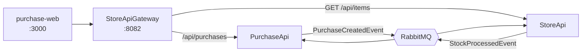

# purchase-web

Marketplace-style web front end for the purchase system. The user browses the product catalog, buys an item and follows the purchase status as it changes from `Pending` to `Confirmed` or `Rejected`. It talks only to the StoreApiGateway, never directly to the APIs.

## Features

- Storefront with a banner and a product grid, showing price and a stock label (in stock, last units, sold out).
- Search by product title from the header; the term lives in the URL, so results survive a refresh and can be shared by link.
- Product page with description, price, stock and a buy box (quantity, payment method and calculated total).
- "My purchases" page with the item name, quantity, total and status of each purchase.
- Purchase detail page with status, rejection reason, quantity, payment method and total.
- Automatic status updates, since the result of a purchase arrives asynchronously.
- Loading, empty and error states, including a retry button when the catalog cannot be loaded.

## Pages

| Route | Description |
| --- | --- |
| `/` | Storefront; with `?q=term` it shows the search results |
| `/items/[id]` | Product page with the buy box |
| `/purchases` | My purchases (refreshes every 2 seconds) |
| `/purchases/[id]` | Purchase detail (polls while the status is `Pending`) |

## Architecture



The front end only knows the gateway URL. The gateway forwards purchases to the PurchaseApi and exposes only `GET` for items, so item registration is not available to the front end.

## Tech stack

- Next.js (App Router) and React
- TypeScript
- Tailwind CSS v4, with the colors defined as design tokens
- Fetch API, with a small HTTP helper

## Project structure

```
src/
  app/
    page.tsx                storefront (banner, search results and product grid)
    items/[id]/page.tsx     product page
    purchases/
      page.tsx              my purchases
      [id]/page.tsx         purchase detail
    layout.tsx              header and global styles
    globals.css             Tailwind and theme tokens
  features/
    purchases/
      components/           ProductCard, ProductGrid, BuyBox, PurchaseList, StatusBadge
      hooks/                usePurchasePolling, useCatalogNames
      services/             purchaseService (calls to the API)
      constants.ts          payment method labels
      types.ts              types that mirror the API contract
  shared/
    components/             Header, Banner, Card, Button, ErrorMessage
    http.ts                 fetch wrapper and ApiError
    formatCurrency.ts       BRL formatting
```

The `app` folder only holds routes. The purchase feature keeps its own types, services, hooks and components, and `shared` holds what is not specific to purchases.

## Running

Prerequisites: Node.js and the StoreApiGateway, PurchaseApi and StoreApi running (see their READMEs).

```bash
npm install
npm run dev
```

The app runs at http://localhost:3000.

Create a `.env.local` file in the project root (restart `npm run dev` after changing it):

```
NEXT_PUBLIC_API_URL=http://localhost:8082
```

## API contract

| Method | Route | Used for |
| --- | --- | --- |
| GET | /api/items?page=1&pageSize=50 | Item catalog (title, price and stock) |
| GET | /api/items/{id} | Product page (404 when it does not exist) |
| GET | /api/purchases | Purchase list |
| GET | /api/purchases/{id} | Purchase detail (404 when it does not exist) |
| POST | /api/purchases | Create a purchase |

Request body to create a purchase:

```json
{
  "itemID": "6ad4def84c3f10514043a630",
  "paymentType": "CreditCard",
  "quantity": 1,
  "total": 1
}
```

`paymentType` is one of `Cash`, `CreditCard`, `DebitCard` and `EletronicTransfer` (spelled as in the API). The `status` field comes back as text: `Pending`, `Confirmed` or `Rejected`.

## Design decisions

- **Search in the URL:** the header form navigates to `/?q=term`, and the home page reads the parameter. The term is not React state, so it survives a refresh and works with the back button. The filter ignores case and accents and runs on the client over the loaded catalog.
- **Polling for status:** the PurchaseApi answers right away with `Pending`, and the final result arrives later through RabbitMQ. After buying, the user is taken to the purchase detail, which asks for the purchase every 1.5 seconds while it is `Pending` and stops on its own when the status changes.
- **Single entry point:** the front end uses one base URL (the gateway), so CORS is configured in one place and the StoreApi stays internal.
- **Data access in one file:** `purchaseService.ts` is the only place that knows the routes. Components receive plain data and know nothing about HTTP.
- **Error handling:** `ApiError` carries the HTTP status, so a 404 is shown as "not found" while a network failure or a 500 shows an error message. When a refresh fails, the last loaded list stays on screen.
- **Stock is not checked on screen:** the stock is shown to help the user, but the purchase is not blocked. Rejecting for insufficient stock is the StoreApi's job, and the result appears as a `Rejected` purchase with its reason.
- **Theme tokens:** colors (page, surface, line, text, header, action) are defined once in `globals.css` with Tailwind's `@theme`, so changing the look means changing one file.
- **Component state in the right place:** pages are Server Components when they only read the URL, and Client Components when they fetch data or hold state.

## Known limitations

- The total is calculated on the client and sent in the request. The back end does not revalidate it, so the proper fix is on the StoreApi: validate `price * quantity` when processing the purchase.
- Each purchase has a single item, so there is no shopping cart.
- The catalog is loaded once, with a single page of up to 50 items, and the search runs only over those items. A larger catalog needs server-side search and pagination.
- Items have no images in the API, so the product cards show a placeholder with the initial of the title.
- There is no authentication.
- Status updates use polling. WebSocket or Server-Sent Events would avoid repeated requests, but need support in the back end.